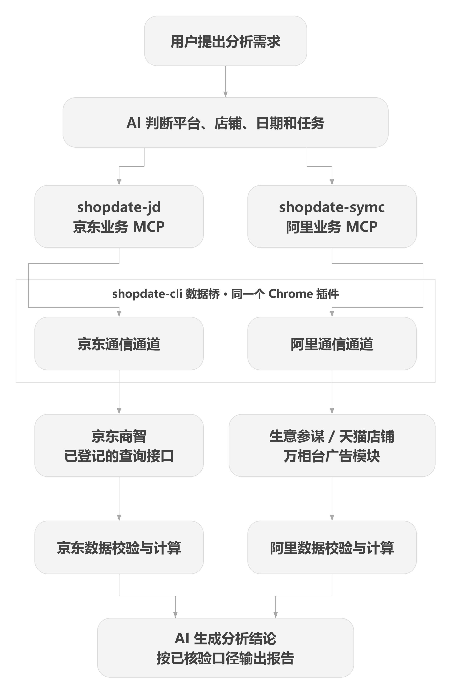

# 京东商智 生意参谋 shopdate MCP

京东商智、生意参谋、万相台只读数据 MCP 工具集。通过本机 Chrome 数据桥，在本人已登录、已授权的后台读取数据，为 AI 助手提供经营分析入口。包含业务源码、Windows/macOS 安装脚本及多客户端 MCP 配置。


## 使用须知

- 仅读取本人有权限的店铺数据，不提供下单、改价、广告关停等业务写操作。
- 取数只调用对应的 shopdate MCP，不使用 Computer Use；接口缺失就列为缺口，不改用其他通道补取。
- 需要64位 Python 3.11+、Chrome 116+；浏览器后台登录和验证码由用户处理。
- 提供正式版安装包；Windows安装及协议已验证，Mac实机、部分客户端对话调用尚未验证，见[兼容性与验证范围](docs/VALIDATION.md)。

## 安装

需要 **64 位 Python 3.11+、Chrome 116+**，以及支持本地 MCP 的 AI 客户端。安装方式二选一即可。

### 方式一：在 Agent 中用一句话安装

将下面这段话发送给具有本地终端权限的 Agent：

> 请从 https://github.com/deva998/shopdate-MCP/releases/latest 下载最新正式版 ZIP，校验同名 SHA256 文件后解压，按 AGENT_INSTALL.md 安装并接入当前客户端，保留其他 MCP 配置；检查两个服务能否启动和调用，提示我完成插件加载、后台登录及客户端授权，最后说明是否安装成功，有问题时给出具体错误。

按照 Agent 提示完成 Chrome 插件加载、后台登录和 MCP 信任授权即可。如果 Agent 无法执行本地安装，改用下面的手动方式。[Agent 安装说明](AGENT_INSTALL.md)

### 方式二：手动安装

#### 1. 下载项目

下载[最新正式版 v1.2.0 ZIP](https://github.com/deva998/shopdate-MCP/releases/download/v1.2.0/shopdate-MCP-v1.2.0.zip)及[SHA256 校验文件](https://github.com/deva998/shopdate-MCP/releases/download/v1.2.0/shopdate-MCP-v1.2.0.zip.sha256)，放在同一目录。Windows 运行下列命令，将 Hash 与校验文件第一列对照；Mac 可直接校验：

```powershell
Get-FileHash .\shopdate-MCP-v1.2.0.zip -Algorithm SHA256
Get-Content .\shopdate-MCP-v1.2.0.zip.sha256
```

```sh
shasum -a 256 -c shopdate-MCP-v1.2.0.zip.sha256
```

校验一致后解压。也可直接克隆仓库：

```sh
git clone https://github.com/deva998/shopdate-MCP.git
cd shopdate-MCP
```

后续命令都在项目目录中执行。

#### 2. 运行安装脚本

**Windows PowerShell：**

```powershell
powershell -NoProfile -ExecutionPolicy Bypass -File .\install.ps1
```

**macOS：**

```sh
sh ./install.sh
```

安装完成后会输出：

- `MCP_CONFIG_EXPORT`：AI 客户端配置目录。
- `CHROME_EXTENSION`：Chrome 插件目录。

若官方源下载缓慢、长时间解析依赖或超时，可在 Windows 命令末尾追加 `-IndexUrl https://pypi.tuna.tsinghua.edu.cn/simple`；macOS 追加 `--index-url https://pypi.tuna.tsinghua.edu.cn/simple`。

#### 3. 加载插件并登录后台

1. 在 Chrome 打开 `chrome://extensions`，开启开发者模式。
2. 点击“加载已解压的扩展程序”，选择 `CHROME_EXTENSION` 输出的目录。
3. 保持插件启用，在同一 Chrome 登录需要使用的京东商智、生意参谋或万相台后台。

Windows 和 Mac 均按上述方式加载本包数据桥。不要移动或删除已加载的插件目录。

v1.2.0共用插件已移到根目录 `extension/`，安装器的 `CHROME_EXTENSION` 会输出新路径；数据桥仍为 **0.9.62**。旧用户推荐新版ZIP安装到新目录，保留原已加载插件目录；不要在Chrome正使用的旧插件仓库原地拉取此次改版，详见[升级说明](extension/README.md)。

#### 4. 接入 AI 客户端

在 `MCP_CONFIG_EXPORT` 目录中，选择对应客户端的配置，合并到客户端 MCP 设置中：

| 客户端 | 配置位置 |
|---|---|
| Codex | `codex/config.toml` |
| Claude Code | `claude-code/.mcp.json` |
| Claude Desktop | `claude-desktop/mcp.json` |
| Cursor | `cursor/mcp.json` |
| TRAE | `trae/mcp.json` |
| WorkBuddy | `workbuddy/` 下两个服务分别导入 |

保留其他已有服务，完成后刷新 MCP 或重启客户端，并按提示授权。接着完成下方“检查是否安装成功”。

Windows 全新在线安装（HTTPS镜像）及生成配置的MCP调用已复测，见[验证记录](docs/WINDOWS_INSTALL_VERIFICATION.md)。Mac实机和部分客户端对话调用仍待验证，见[兼容性范围](docs/VALIDATION.md)。

## 功能

| 场景 | 提供的作用 |
|---|---|
| 京东商智 | 店铺概况、商品、库存、交易退款及行业等查询入口，平台参数jd |
| 生意参谋 | 本店商品、交易退款、营销、客户／内容／服务，以及部分市场榜单、趋势与竞品查询，平台参数sycm |
| 万相台 | 计划、活动及广告报表等查询与复盘入口，平台参数alimama |
| 日常分析 | 通过guide和workflow_catalog查看日检、复盘、诊断等方法及实现状态 |
| 数据核验 | 核对店铺身份、统计日期、字段口径、分页与质量标记；缺失不补零、不用其他指标替代 |

[查看完整功能清单：京东 / 阿里](功能清单.md)。市场接口为部分接入；权限、日期、筛选和分页覆盖以实际返回为准，不能用本店类目销售替代行业排名。

## 业务流程



[查看 Mermaid 源码](docs/diagrams/business-workflow.mmd)（维护流程时请同步更新 PNG）。

图中展示已登记接口的处理路径；不是完整平台功能覆盖承诺，跨平台对比须先核对可比口径。环境检查、账号授权、接口实现、实际取数和数据完整性分别验收。接口缺失时不切换Computer Use或其他取数通道；风控发生后停止重试，用户完成验证后才可重新查询。

## 检查是否安装成功

无论使用哪种安装方式，完成后都可以对 Agent 说：

> 请检查 shopdate-jd 和 shopdate-symc 是否可调用，先调用 commands，再通过对应 MCP 的 doctor 检查数据桥和后台登录；分别报告成功或具体错误，不查询经营报表。

两个服务能返回帮助，需要使用的平台数据桥及登录检查正常，即完成基本安装，可以开始使用。

如果客户端还未接通，可先在项目目录检查本地服务：

**Windows：**

```powershell
.\.venv\Scripts\python.exe -B scripts/check_mcp.py
```

**macOS：**

```sh
./.venv/bin/python -B scripts/check_mcp.py
```

输出 `"status": "passed"` 表示本地 MCP 服务正常，接下来重点检查客户端配置；这不代表所有业务接口都已取数成功。

## 常见问题

| 问题 | 处理方法 |
|---|---|
| 找不到 Python | 安装64位 Python 3.11+，重新打开终端 |
| 依赖下载失败 | 使用上面的 HTTPS 镜像参数重试 |
| 客户端看不到工具 | 核对配置路径，刷新服务或重启客户端 |
| 数据桥无法连接 | 保持 Chrome 运行，确认插件启用、目录未移动 |
| 提示未登录或安全验证 | 在本人 Chrome 中手动完成登录或验证 |

## 仓库文件

普通使用者看本页、[功能清单](功能清单.md)和[Agent安装教程](AGENT_INSTALL.md)即可。安装脚本、源码、依赖和LICENSE需保留；更新记录、兼容性与来源说明已收进docs。[各文件用途](docs/仓库文件说明.md)

## 开发与反馈

有想法、有需求，欢迎私信交流。想要帮你装好、按你的需求定制，也可以直接问。

-邮箱：vikk328327@gmail.com

-X：@Amber0880

如果这个工具帮到了你，欢迎给个 ⭐️。

## 协议与来源

[MIT许可证](LICENSE)。本项目包含本地定制，功能和安装方式以本仓库说明为准。用于查询本人有权限的后台数据，请遵守平台规则。
