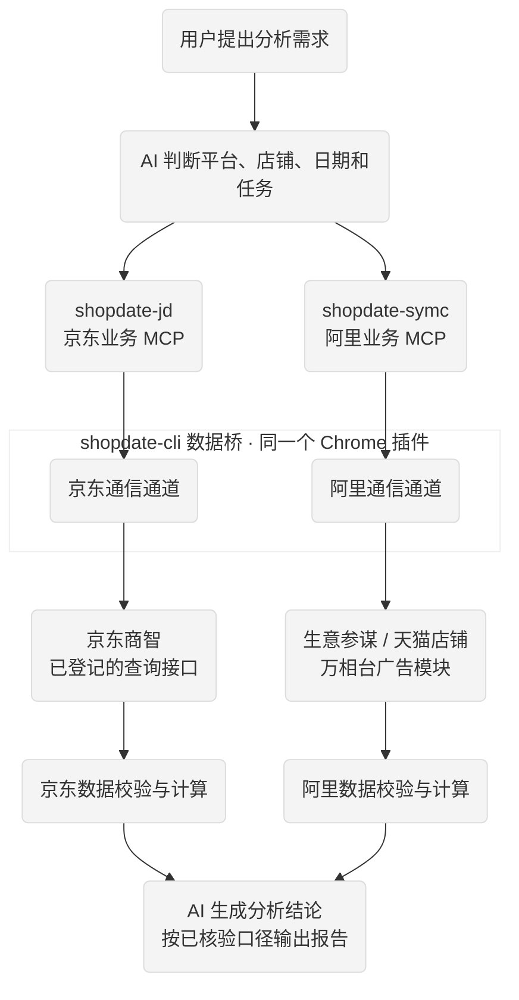

# 京东商智 生意参谋 shopdate MCP

京东商智、生意参谋、万相台只读数据 MCP 工具集。通过本机 Chrome 数据桥，在本人已登录、已授权的后台读取数据，为 AI 助手提供经营分析入口。包含业务源码、Windows/macOS 安装脚本及多客户端 MCP 配置。


## 使用须知

- 仅读取本人有权限的店铺数据，不提供下单、改价、广告关停等业务写操作。
- 取数只调用对应的 shopdate MCP，不使用 Computer Use；接口缺失就列为缺口，不改用其他通道补取。
- 需要64位 Python 3.11+、Chrome 116+；浏览器后台登录和验证码由用户处理。
- 本版为公开测试版：Windows安装及协议已验证；Mac实机、部分客户端对话调用尚未验证，见[兼容性与验证范围](docs/VALIDATION.md)。

## 安装

### 1. 下载工具

没有Git时，可从本仓库页面选择 **Code → Download ZIP**，解压到固定位置；也可运行：

```sh
git clone https://github.com/vikk-hi/shopdate-MCP.git
cd shopdate-MCP
```

进入包含 `installer.py`、`components` 和 `install.ps1` 的目录再执行安装。不要移动已安装的虚拟环境到另一台电脑。

### 2. 在 Agent 中用一句话安装

支持本地终端与文件写入的 Agent 可直接接收：

> 请从 https://github.com/vikk-hi/shopdate-MCP.git 克隆 shopdate MCP，按 AGENT_INSTALL.md 安装并接入当前客户端和项目，保留其他 MCP 配置并备份，验证两个服务的连接和 commands 帮助调用，明确列出需我完成的登录、信任和插件步骤，不取业务数据。

[完整教程](AGENT_INSTALL.md)。只有聊天能力、没有本地执行权限的客户端无法自动安装；用户仍需完成登录和授权。

### 3. 手动安装

**Windows PowerShell**

```powershell
powershell -NoProfile -ExecutionPolicy Bypass -File .\install.ps1
```

需指定Python时追加 `-Python 'Python可执行文件的绝对路径'`；执行策略仅对本次脚本进程生效。

**macOS**

```sh
sh ./install.sh
```

默认使用 `python3`；也可 `SHOPDATE_PYTHON=/absolute/path/to/python3 sh ./install.sh`。不需要sudo。Mac脚本与配置已提供，Intel/Apple Silicon尚未完成实机验收。

安装器创建独立 `.venv`、安装依赖、检查两侧服务，再输出 `MCP_CONFIG_EXPORT` 配置目录和 `CHROME_EXTENSION` 插件目录。安装器本身不修改Agent现有设置；重复运行生成新的配置批次。

下载依赖超时时，可显式选择HTTPS镜像，仅影响本次安装：

```powershell
powershell -NoProfile -ExecutionPolicy Bypass -File .\install.ps1 -IndexUrl https://pypi.tuna.tsinghua.edu.cn/simple
```

```sh
sh ./install.sh --index-url https://pypi.tuna.tsinghua.edu.cn/simple
```

不关闭TLS验证。离线安装需自行准备系统、架构及Python版本匹配的wheelhouse：Windows追加 `-Offline -Wheelhouse '绝对路径'`；Mac追加 `--offline --wheelhouse /absolute/path/to/wheelhouse`。

### 4. 加载 Chrome 数据桥

Windows 和 macOS 都需要加载同一份插件，京东及账号核验不能跳过：

1. 在本人 Chrome 打开 `chrome://extensions`，开启开发者模式。
2. 点击“加载已解压的扩展程序”，选择安装器输出的 `components/jd/extension/unpacked`。
3. 确认名称 `shopdate-cli 数据桥`、版本 `0.9.40`、ID `nipicallldlddjelmaghkbbjaannlpib`，保持启用。
4. 在同一 Chrome 登录要读取的后台；保持 Chrome 运行。更新插件文件后在扩展页点击“重新加载”。

不要点击“打包扩展程序”。加载目录不能删除或随意移动。现有包没有浏览器商店一键安装链接；用户仍需手动加载与登录。不要导出、上传或分享账号登录态。manifest 公钥决定固定插件 ID，不能随意替换。

数据桥仅监听本机回环服务，并按平台注册接口读取；Chrome 插件保存在本机的账号信息不随此包交付。取数结果会交给选用的 Agent 客户端，后续模型处理受该客户端的数据政策约束；本地数据桥不等于模型处理完全离线。

### 5. 接入 AI 助手

在安装器输出目录按需取用配置。只合并 shopdate 两个服务，不整份覆盖其他服务。两个服务分别叫 shopdate-jd、shopdate-symc；内部平台参数仍为 jd、sycm、alimama。

| 客户端 | 生成文件与方法 | 状态 |
|---|---|---|
| Codex | `codex/config.toml`，合并到客户端实际使用的 config.toml | 标准握手验证；超时已配置，不用旧的工具白名单 |
| Claude Code | `claude-code/.mcp.json`；放到需要的项目根目录并合并已有配置，按提示确认本地服务 | 临时原生CLI两服务Connected；Agent调用因未登录未完成 |
| Claude Desktop | `claude-desktop/mcp.json`；通过设置打开实际配置文件，合并 mcpServers | 待客户端实机验收 |
| Cursor | `cursor/mcp.json`；合并到 Cursor MCP 配置 | 待客户端实机验收 |
| TRAE | `trae/mcp.json`；自定义 MCP 中导入，支持 command/args/env | 原生CLI导入通过；前端调用未验证 |
| WorkBuddy | `workbuddy/shopdate-jd/mcp.json` 与 `workbuddy/shopdate-symc/mcp.json`，分别添加两个本地stdio连接器 | 内置CLI两服务Connected；Agent调用因未登录未完成 |
| 豆包工作 | `doubao/mcp.json`，仅在所用版本确有本地STDIO入口时按字段配置 | 条件模板，未承诺已适配；只有HTTP地址入口时不能直接接入 |
| 其他客户端 | `generic/mcp.json`，使用相同启动命令、参数、环境变量 | 必须支持在同一电脑启动stdio子进程 |

`mcp-configs/examples/` 中是 Windows/macOS 占位示例；不能直接运行，优先使用安装器生成的实际路径配置。网页端、手机端或云端 MCP 只有远程URL入口时，不能用数据桥的127.0.0.1端口替代远程MCP。本包不新增HTTP代理。

## 功能

| 场景 | 提供的作用 |
|---|---|
| 京东商智 | 店铺概况、商品、库存、交易退款及行业等查询入口，平台参数jd |
| 生意参谋 | 本店商品、交易退款等查询与分析入口，平台参数sycm |
| 万相台 | 计划、活动及广告报表等查询与复盘入口，平台参数alimama |
| 日常分析 | 通过guide和workflow_catalog查看日检、复盘、诊断等方法及实现状态 |
| 数据核验 | 核对店铺身份、统计日期、字段口径、分页与质量标记；缺失不补零、不用其他指标替代 |

[查看完整功能清单：京东 / 阿里](功能清单.md)。提供入口不等于每个账号、日期和模块均已取到完整数据。天猫行业/市场排名目前未接入，不能用本店类目销售替代。

## 业务流程



图中展示已登记接口的处理路径；不是完整平台功能覆盖承诺，跨平台对比须先核对可比口径。环境检查、账号授权、接口实现、实际取数和数据完整性分别验收。接口缺失时不切换Computer Use或其他取数通道；风控发生后停止重试，用户完成验证后才可重新查询。

## 检查安装

在尚未安装的源码目录检查文件清单（支持Git克隆目录，会跳过根目录Git元数据）：

```powershell
py -3-64 -B scripts/verify_release.py
```

Mac将 `py -3-64` 换成 `python3`。安装后用虚拟环境Python检查MCP协议，不读取业务数据：

```powershell
.\.venv\Scripts\python.exe -B scripts/check_mcp.py
```

Mac：`./.venv/bin/python -B scripts/check_mcp.py`。随后在Agent中检查两个服务是否可用，并实际调用commands帮助；Connected不代表Agent对话调用已成功。开始业务查询前，通过MCP核对账号、日期和返回质量。

## 常见问题

| 现象 | 处理方法 |
|---|---|
| Python不存在或为32位 | 安装64位Python 3.11+；Windows可通过 -Python 指定实际解释器 |
| 依赖下载超时 | 查看上面的HTTPS镜像安装方法；不关闭证书验证 |
| TRAE无法启动带空格的command | 使用安装器生成的TRAE配置，保留args数组；详见AGENT_INSTALL.md |
| Connected但Agent没有调用工具 | 核对客户端登录、项目MCP信任和工具权限；Connected不代表模型调用已完成 |
| 客户端只接受HTTP URL | 本包提供本地stdio，不能把数据桥端口填成远程MCP地址 |
| 同名MCP配置冲突或文件是JSONC | 合并器会停止；在客户端设置中核对并处理，不覆盖其他服务 |
| 业务查询触发验证码/风控 | 停止重试，由用户在本人浏览器人工完成验证 |

| 其他问题 | 处理方法 |
|---|---|
| 没有连接数据桥 | 保持Chrome运行、扩展启用，确认加载目录未移动或删除 |
| 返回0条但预期有数据 | 核对账号权限、统计日期、参数和返回质量；0条不自动解释为零销量 |
| 多个Agent共用安装目录 | 可分别登记同一安装路径；数据桥排队，不承诺并行业务取数 |
| 文件哈希检查失败 | 使用新的干净源码目录核对；不要为通过检查删除现有业务数据或Git仓库 |

## 仓库文件

普通使用者看本页、[功能清单](功能清单.md)和[Agent安装教程](AGENT_INSTALL.md)即可。安装脚本、源码、依赖和LICENSE需保留；更新记录、兼容性与来源说明已收进docs。[各文件用途](docs/仓库文件说明.md)

## 开发与反馈

有想法、有需求，欢迎加微信找我，并注明来意。想要帮你装好、按你的需求定制，也可以直接问。

-微信：扫下方二维码加好友

-X / Twitter：@Amber0880


如果这个工具帮到了你，欢迎给个 ⭐️。

## 协议与来源

[MIT许可证](LICENSE)。本项目包含本地定制，功能和安装方式以本仓库说明为准。用于查询本人有权限的后台数据，请遵守平台规则。
